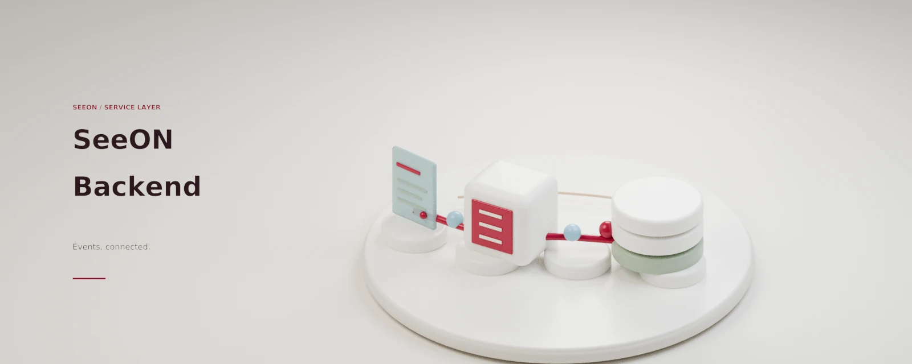

<p align="center">
  
</p>

<p align="center"><sub>SENIOR AI LAB · SEEON</sub></p>

<h1 align="center">SeeON Backend</h1>

<p align="center">
  <strong>SeeON 제품 API와 시설 운영 데이터 경계를 담당하는 백엔드</strong><br />
  NestJS · PostgreSQL · nginx · Jenkins
</p>

<p align="center">
  <a href="#시작하기">시작하기</a> ·
  <a href="./docs/architecture.md">아키텍처</a> ·
  <a href="#명령어와-검증">명령어와 검증</a> ·
  <a href="#배포와-보안">배포와 보안</a>
</p>

SeeON 백엔드는 웹 클라이언트와 엣지 런타임이 사용하는 제품 API, 시설 단위 데이터 접근, 이벤트·알림 저장, 미디어 접근 경계 및 백엔드 배포 도구를 소유합니다. NestJS 애플리케이션, PostgreSQL/Prisma, API 전용 nginx ingress로 구성됩니다. 프런트엔드와 엣지 추론 런타임은 별도 저장소에서 관리합니다.

## 저장소 역할

| 영역 | 이 저장소의 책임 |
|---|---|
| 제품 API | 버전이 지정된 HTTP API, 인증·권한, 시설 구조, 이벤트와 알림 조회·조치 |
| 데이터 | Prisma 스키마와 PostgreSQL 마이그레이션, 시설 범위 RLS 경계 |
| 운영 경계 | API 전용 nginx ingress, 로컬/운영 Compose, 릴리스·Jenkins 배포 도구 |
| 비소유 영역 | 대시보드 UI, 카메라 RTSP 소비·추론, 모델 학습·데이터셋 관리 |

`SeeON-Front`는 `FRONT_ORIGINS`에 명시된 외부 브라우저 클라이언트입니다. 이 저장소에는 프런트엔드 빌드나 서비스가 없습니다. 엣지 카메라 처리와 모델·데이터셋 수명주기도 여기에 포함되지 않습니다.

## 문서 길잡이

```bash
backend/src/       # NestJS API, 인증·도메인·미디어 모듈
backend/prisma/    # Prisma 스키마, 마이그레이션, 시드 및 DB 역할 초기화
infra/             # API ingress nginx 및 Jenkins 컨트롤러 이미지 정의
scripts/           # 로컬 실행, 환경 계약, 저장소 가드, 릴리스·배포 도구
docs/              # 아키텍처, OpenAPI, 결정 기록, 추출 이력
compose*.yaml      # PostgreSQL 로컬 스택 및 백엔드 운영 오버레이
```

- [아키텍처와 계약 경계](./docs/architecture.md)
- [OpenAPI v1 계약](./docs/openapi/v1.json) · 실행 중 문서 UI: `/api/docs`
- [추출 이력과 커밋 맵](./docs/provenance/README.md)
- [릴리스 기반 CD 결정](./docs/decisions/ADR-002-release-based-cd.md)
- [기여·마이그레이션·배포 규칙](./AGENTS.md)

## 시작하기

### 필수 도구

| 도구 | 버전·용도 |
|---|---|
| Node.js | 24 이상 (`.nvmrc` 기준 24) |
| pnpm | 10.32.1 (`package.json`의 `packageManager`) |
| Docker Compose | 로컬 PostgreSQL 실행에 필요 |

### 개발 서버 실행

저장소 루트에서 실행합니다. 개발 도구는 루트 `.env.local`만 사용합니다.

```bash
node --version                 # v24 이상
pnpm --version                 # 10.32.1
docker info                    # Docker 데몬 동작 확인
pnpm install
cp .env.local.example .env.local
pnpm env:local:verify
pnpm dev:backend
```

`pnpm dev:backend`는 로컬 환경 계약을 확인하고 PostgreSQL 컨테이너를 올린 뒤 Prisma Client 생성, `prisma migrate dev`, NestJS watch 서버 실행을 차례로 수행합니다. 기본 API 주소는 `http://localhost:8080`, OpenAPI UI는 `http://localhost:8080/api/docs`입니다. 전체 로컬 Compose 스택(db, backend, api-ingress)이 필요하면 `pnpm compose:local:up`을 사용합니다. ingress 포트는 기본 `3001`입니다.

로컬 `/health`는 DB 연결뿐 아니라 배포 SHA도 검사합니다. 로컬 실행에 유효한 40자리 `DEPLOY_SHA`가 설정되지 않았다면 DB가 정상이어도 `sha: "unknown"`, HTTP 503을 반환할 수 있습니다. 이를 배포 상태나 제품 준비도의 판정으로 해석하지 마세요.

> **주의:** `.env.local.example`은 로컬 개발용입니다. `pnpm dev:backend:fresh`는 보호 검사를 거쳐 로컬 DB를 초기화하고 데모 데이터를 넣으므로, 필요한 데이터가 있는 DB에는 실행하지 마세요. 실제 `.env.local` 및 `.env.host.prod`는 커밋하지 말고 `backend/.env*` 같은 패키지별 환경 파일도 만들지 마세요. 외부 SMTP 전달이 필요하지 않다면 템플릿의 SMTP 예시값을 실제 자격 증명으로 바꾸지 마세요.

## 명령어와 검증

| 명령 | 목적 |
|---|---|
| `pnpm dev:backend` | 환경 검증, DB 시작·마이그레이션, NestJS watch 실행 |
| `pnpm dev:backend:app` | 이미 DB와 스키마가 준비된 경우 NestJS만 실행 |
| `pnpm dev:backend:fresh` | **로컬 DB 초기화·시드 후** watch 실행; 데이터 삭제 주의 |
| `pnpm compose:local:up` | 로컬 db·backend·api-ingress Compose 전체 실행 |
| `pnpm typecheck` | 백엔드 TypeScript 검사 |
| `pnpm lint` | 백엔드 아키텍처 계약 검사와 ESLint |
| `pnpm --filter backend test` | Jest 단위·통합 테스트; 일부 테스트는 PostgreSQL 필요 |
| `pnpm --filter backend run dto:check` | 요청·응답 DTO 규칙 검사 |
| `pnpm env:verify` | Compose·nginx·환경·배포 계약 검사 |
| `pnpm --filter backend run smoke:no-db` | DB 없이 실행 가능한 제한된 route-versioning 스모크 |

테스트 전체 실행은 저장소 루트에서 수행합니다. DB 기반 테스트에는 로컬 PostgreSQL과 올바른 `DATABASE_URL`, `DIRECT_URL` 구성이 필요합니다. e2e 명시 실행은 `pnpm --filter backend run test:e2e`이며 같은 환경 요구사항을 먼저 확인하세요. 작업별 필수 가드와 마이그레이션 절차는 [AGENTS.md](./AGENTS.md)를 따릅니다. `pnpm format`은 검사 명령이 아니라 소스 파일을 수정하는 포매터입니다.

## 배포와 보안

- 운영 배포는 검증된 `main`의 안정 릴리스 `vX.Y.Z` 공개로 시작합니다. GitHub Actions는 Jenkins에 신호를 보내고, Jenkins가 태그와 커밋 SHA 및 해당 SHA의 CI gate를 확인한 뒤 백엔드·API ingress 이미지를 빌드하고 배포합니다. 프런트엔드와 엣지 런타임 이미지는 이 저장소에서 빌드하지 않습니다.
- 배포는 DB 사전 덤프, `prisma migrate deploy`, Compose 기동, `/health`의 릴리스 SHA 확인으로 완료를 판별합니다. 릴리스 신호만으로 배포 완료를 주장할 수 없으며, DB 복원은 실패 시 자동 실행되지 않습니다. 이전 안정 태그로 롤백하는 운영 절차는 [CD 결정](./docs/decisions/ADR-002-release-based-cd.md)과 배포 규칙을 확인하세요.
- 운영 환경 변수는 호스트에서 관리합니다. 커밋된 템플릿, 이 README, 로그에 비밀값을 넣지 마세요. 운영의 `SESSION_JWT_SECRET`, DB URL, SMTP, edge 토큰 pepper 등은 환경별 비밀 저장소에서 관리해야 합니다.
- 브라우저 세션은 HttpOnly 쿠키이며, CORS는 `FRONT_ORIGINS` 허용 목록을 사용합니다. 프로덕션 쓰기 요청은 기본적으로 Origin/Referer 검사를 받으며, 명시적으로 CSRF 검사를 건너뛰는 machine API 경로는 별도 Edge 인증을 사용합니다. Edge 자격 증명은 브라우저 사용자 세션과 별개입니다. URL, 로그, 예시에 실제 자격 증명·카메라 위치·프레임 또는 미디어 페이로드를 기록하지 마세요.
- 이벤트 스냅샷과 클립은 로컬 저장 경계가 있으며 운영 배포에서 지속성 볼륨 및 호스트 미디어 정책이 중요합니다. 기능·보존 동작은 환경과 설정에 종속됩니다. 이 문서는 운영 승인, 보안 인증, SLA, 성능 벤치마크 또는 제품 준비 상태를 보증하지 않습니다.

## SeeON 저장소

- [SeeON-Front](https://github.com/SeniorAILab/SeeON-Front) — 시설 운영 대시보드
- [SeeON-edge](https://github.com/SeniorAILab/SeeON-edge) — 카메라·엣지 런타임
- [SeeON-Model](https://github.com/SeniorAILab/SeeON-Model) — 모델 작업
- [SeeON-Dataset](https://github.com/SeniorAILab/SeeON-Dataset) — 데이터셋 작업
- [SeeON-Backend](https://github.com/SeniorAILab/SeeON-Backend) — 현재 저장소

이 저장소는 `SeniorAILab/SeeON`에서 분리되었습니다. 원본과 커밋 연결은 [추출 이력](./docs/provenance/README.md)을 참고하세요. 상단 이미지는 개념 아트워크이며 실제 배포 환경이나 제품 준비 상태를 나타내지 않습니다.

[Artwork provenance](./docs/ARTWORK.md) · Original procedural Blender/Cycles reconstruction.
