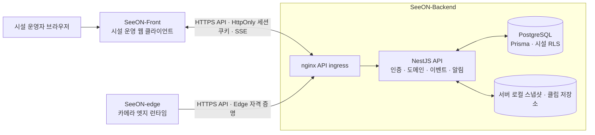
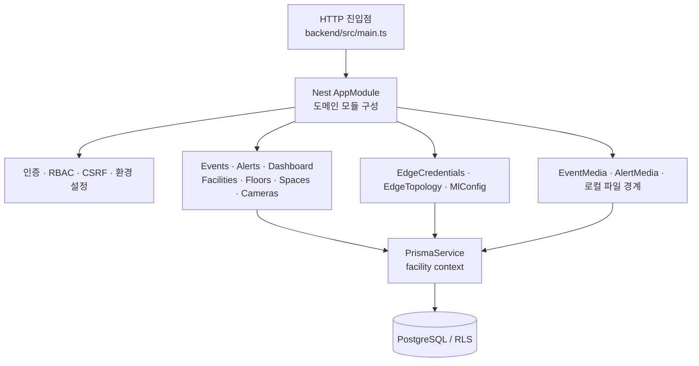
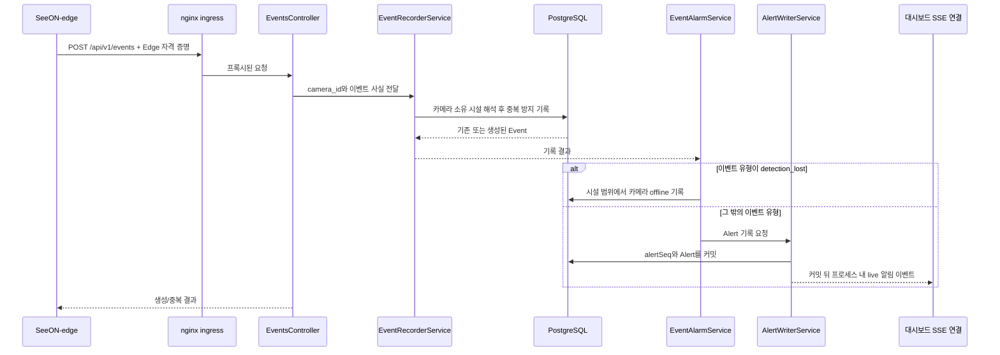

# SeeON Backend 아키텍처

이 문서는 현재 저장소의 구현을 설명합니다. 운영 절차는 [저장소 규칙](../AGENTS.md), 배포 결정은 [ADR-002](./decisions/ADR-002-release-based-cd.md), 기계 판독 가능한 API 스키마는 [OpenAPI v1](./openapi/v1.json)을 기준으로 확인하세요. 코드는 `backend/src/`와 `backend/prisma/`가 권위 있는 출처입니다.

## 시스템 컨텍스트

SeeON-Backend는 시설 운영 API입니다. 웹 클라이언트와 엣지 런타임은 서로 다른 인증 경계로 API에 접근합니다. 화면·추론 자체, RTSP 카메라 스트림 소비, 데이터셋·모델 작업은 이 저장소가 소유하지 않습니다.

`FRONT_ORIGINS`는 브라우저 호출의 허용 Origin 목록이며, 인증·시설 권한을 대신하지 않습니다. 배포 시 이 저장소는 백엔드와 API ingress 이미지만 관리합니다. 프런트엔드와 엣지 이미지는 각 저장소의 배포 경계입니다.

## 컴포넌트와 코드 맵

| 경로 | 책임 |
|---|---|
| [`backend/src/main.ts`](../backend/src/main.ts) · [`app.module.ts`](../backend/src/app.module.ts) | HTTP 파이프라인, `/api` 접두사와 URI 버전, Swagger, Nest 모듈 조립 |
| `backend/src/auth/`, `security/`, `config/` | 세션·RBAC, CSRF Origin 확인, CORS와 런타임 환경 검증 |
| `backend/src/facilities/`, `floors/`, `spaces/`, `cameras/` | 시설 → 층 → 공간(룸) → 카메라 토폴로지와 소유권 연결 |
| `backend/src/events/` | Edge 이벤트·heartbeat·스냅샷 수신, 중복 식별과 이벤트 기록 |
| `backend/src/alerts/`, `dashboard/` | 알림 쓰기·조회·상태 변경, 시설 범위 대시보드 SSE와 수신 확인 |
| `backend/src/edge-credentials/`, `edge-topology/`, `ml-config/` | Edge 설치 자격 증명·토폴로지 계약·런타임 설정 API |
| `backend/src/media/` | Edge 클립 수신과 상태, 사용자 미디어 조회·접근 감사 |
| [`backend/src/prisma/prisma.service.ts`](../backend/src/prisma/prisma.service.ts) · `backend/prisma/` | Prisma 경계, 테넌트 컨텍스트, 스키마·PostgreSQL 초기화·마이그레이션 |
| `infra/api-ingress/`, `compose.yaml`, `compose.prod.yaml` | API 전용 프록시, 로컬 스택, 운영 Compose 계약 |
| `scripts/`, `.github/workflows/`, `Jenkinsfile` | 환경·저장소 계약 검사, 릴리스 신호 및 운영 배포 자동화 |

구현 규칙은 컨트롤러 → 서비스 → 저장소 경계를 따릅니다. API 계약과 스키마는 각각 소유 도메인의 DTO와 Prisma 스키마에서 관리하며, 교차 저장소 통합은 HTTP·DTO·이벤트 계약을 사용합니다.

## API와 인증 경계

`main.ts`는 `/` 및 `/health`를 제외한 경로에 `/api`를 붙이고 URI 버전을 사용합니다. 현재 기본 API 버전은 `v1`이며 실행 중 Swagger UI는 `/api/docs`입니다. 공개된 계약은 OpenAPI 파일을 생성된 Nest 문서에 합쳐 제공합니다.

| 호출 주체 | 주요 경로 예 | 인증·범위 |
|---|---|---|
| 웹 클라이언트 | `/api/v1/auth/login`, `/api/v1/auth/me`, `/api/v1/facilities`, `/api/v1/spaces`, `/api/v1/cameras`, `/api/v1/alerts`, `/api/v1/events` | `app_session` HttpOnly 쿠키, 역할 capability, 사용자 시설 범위 |
| 대시보드 실시간 피드 | `/api/v1/dashboard/stream` | 세션 및 시설 범위. `alert` 이벤트는 `alertSeq`를 SSE ID로 사용 |
| Edge 이벤트 | `/api/v1/events`, `/api/v1/events/heartbeat`, `/api/v1/events/:eventId/snapshot` | `EdgeIngestTokenGuard`; 시설·카메라 또는 이벤트 소유권은 서버가 조회 |
| Edge 미디어 | `/api/v1/events/capabilities`, `/api/v1/events/clips/:clipId` 및 상태 경로 | Edge 자격 증명; 클립 기능 플래그와 저장 용량 정책 적용 |
| Edge 관리 | `/api/v1/edge/enrollments/*`, `/api/v1/admin/edge-credentials/*`, `/api/v1/edge/topology-snapshots/*` | 등록 토큰, 설치 자격 증명 또는 관리자 세션 등 경로별 가드 |
| 운영 확인 | `/health` | DB 연결과 유효한 `DEPLOY_SHA`를 확인하는 제한된 프로세스 점검 |

브라우저 로그인은 JWT를 HttpOnly 쿠키로 설정하며 전략은 사용자 레코드와 `sessionVersion`을 재검증합니다. 역할은 `SUPER_ADMIN`, `ADMIN`, `STAFF`이고, capability 가드는 작업별 권한을 적용합니다. `SUPER_ADMIN`의 시설 범위 선택도 명시적 컨텍스트가 필요하며, 미디어·메모 등의 시설 규칙을 무조건 우회하지 않습니다.

프로덕션의 CORS는 명시적 `FRONT_ORIGINS` 허용 목록을 사용합니다. 쓰기 메서드는 기본적으로 Origin/Referer CSRF 검사를 받습니다. `AUTH_COOKIE_SAME_SITE=none`은 일반적인 기본값이 아니며 운영 환경에서 `AUTH_COOKIE_SECURE=true` 및 코드에 고정된 임시 bridge Origin 조건을 요구합니다. 브라우저 세션 쿠키와 Edge bearer 자격 증명은 서로 대체할 수 없습니다. Edge v1 설치 자격 증명이 기본 경로이며, 구형 공유 토큰은 명시적으로 켠 전환 호환 경로에서만 허용됩니다.

## 이벤트에서 대시보드까지

이벤트 생성 시 카메라를 서버에서 조회해 `facilityId`와 `spaceId`를 결정합니다. 클라이언트의 시설 선언을 신뢰해 테넌트 범위를 만들지 않습니다. `edge_event_id`가 있으면 시설 범위에서 이를 중복 키로 사용하고, 없는 경우 카메라·탐지 시각·유형으로 중복 키를 만듭니다. 같은 Edge ID가 다른 이벤트 사실과 충돌하면 요청은 충돌로 거부됩니다. Heartbeat는 카메라 상태를 갱신하며 알림을 만들지 않습니다. 스냅샷 업로드는 기존 이벤트를 소유권 확인한 별도 경로입니다.

알림 생성은 `AlertWriterService` 한 곳으로 모입니다. 현재 구현은 프로세스 내 Promise 큐로 insert를 직렬화하고, DB 커밋 이후 같은 프로세스 구독자에게 새 알림을 알립니다. SSE는 시설별 과거 알림을 `alertSeq`로 재생한 뒤 live 구독을 연결하며, 연결 중 세션 유효성을 다시 검사합니다. 상태 변경용 `alert-updated`는 live-only이며 재연결 후 REST 조회가 복구 경로입니다.

### 알림과 이메일 전달은 별도 경계

`AlertEventsService`와 저장소·채널 포트는 전달 outbox 및 SMTP 채널 경계를 구현합니다. 그러나 현재 `/api/v1/events` 경로의 `EventAlarmService`는 알림 도메인 행만 기록하며 outbox/email fan-out을 호출하지 않습니다. `AlertPolicyService`는 현재 조건 없이 dispatch 결정을 반환합니다. 따라서 이 모듈의 존재만으로 실시간 이벤트가 운영 메일을 전달하거나 억제·중복 정책을 자동 수행한다고 해석하면 안 됩니다. 전달 결과에는 일시/운영자 조치 필요 실패 분류가 있지만, 이 문서에서 별도 스케줄러나 자동 재시도 워커를 가정하지 않습니다.

## 시설 격리와 영속성

v1의 운영 토폴로지는 시설 → 층 → 공간(`Space`) → 카메라입니다. 이벤트와 알림은 공간·카메라 기준입니다. v1에 주민/보호자 도메인이나 알림의 주민 키가 있다고 가정하지 마세요.

`PrismaService.withFacilityContext()`는 시설 ID가 설정된 대화형 트랜잭션을 열고 해당 연결에 `SET LOCAL app.facility_id`를 적용합니다. 이 경계 밖에서 tenant model을 사용하면 Prisma 확장이 DB 쿼리 전에 거부하고 PostgreSQL RLS가 추가로 시설 범위를 강제합니다. 앱 런타임 `DATABASE_URL`은 `fall_app` 비소유자·`NOBYPASSRLS` 역할을 사용합니다. `User`는 로그인·온보딩 전 시설 컨텍스트가 없을 수 있어 RLS model 목록에서 빠져 있으며 애플리케이션 인증·권한으로 보호합니다.

`backend/prisma/schema.prisma`가 스키마 기준이며 변경에는 커밋된 SQL 마이그레이션이 필요합니다. `DIRECT_URL`은 마이그레이션·시드 등 privileged 관리 작업용이고 앱 런타임 URL과 분리합니다. 프로덕션은 배포 도구가 `prisma migrate deploy`를 실행합니다. Nest 앱 시작 시 마이그레이션, `db push`, DB 초기화·시드를 실행하지 않습니다.

알림과 이벤트에는 중복 방지 키 및 이벤트 원본 연결이 있습니다. 알림 상태(`NEW` → `ACKED` → `RESOLVED`)는 변경되며, 테이블 전체를 불변 append-only 기록이라고 보아서는 안 됩니다. `alertSeq`는 알림 SSE의 재생 커서입니다. DB 기록 뒤 SSE 전파는 프로세스 내부 메모리에서 일어나므로 이 구현만으로 여러 백엔드 인스턴스 간 이벤트 팬아웃이 보장되지 않습니다.

## 스냅샷·클립 미디어

- Edge가 제공하는 미디어만 받습니다. 스냅샷 키와 파일 경로는 서버가 시설·이벤트 ID를 기반으로 도출하며 원격 URL을 가져오지 않습니다.
- 클립은 DB의 상태·소유권과 로컬 파일을 함께 관리합니다. `READY` 클립은 콘텐츠 불변, 크기·체크섬·시간 메타데이터 대조, Range 다운로드, ETag 및 접근 감사의 대상입니다. 활성 보존 hold는 만료·삭제 동작에 영향을 줍니다.
- 클립 수신·내보내기는 `EVENT_CLIPS_ENABLED=true`가 아니면 fail-closed이며, 보존 일수는 최소 60일로 검증됩니다. 운영 Compose는 `MEDIA_CLIP_DIR`, 보존량·여유 공간 관련 값을 요구하고 스냅샷·클립 볼륨을 마운트합니다. 저장소 실제 위치나 카메라 위치를 문서·로그에 기록하지 마세요.
- 관리자 미디어 조회는 세션, 시설 범위, capability 검사를 적용합니다. 콘텐츠 API는 byte range와 ETag/Last-Modified 의미를 유지하고 접근 이력을 기록합니다. 운영 Linux는 descriptor 기반 경로 격리 기능을 요구하며 누락 시 fail-closed입니다. macOS 개발 대체 동작을 운영 보안 보장으로 간주하지 마세요.

## 장애 동작과 한계

| 조건 | 구현 동작과 해석 |
|---|---|
| 잘못된 운영 환경 | 필수 설정·Origin·쿠키·세션 시크릿 계약이 부팅 검증에서 실패할 수 있습니다. 개발 템플릿을 운영에 복사하지 마세요. |
| 인증·시설 범위 불충족 | 세션·권한·Edge 가드가 요청을 거부합니다. Edge 이벤트의 시설/카메라 소유권은 서버가 해석합니다. |
| 테넌트 컨텍스트 누락 | tenant model 접근은 애플리케이션 가드에서 실패하며 RLS도 무컨텍스트 행 접근을 차단합니다. |
| 이벤트 저장 후 알림 쓰기 실패 | Event와 Alert는 순차 단계입니다. 알림 예외가 이미 커밋된 Event를 자동으로 되돌린다는 보장은 없습니다. Edge 재전송은 이벤트 중복 키를 사용하지만 전체 처리를 단일 원자 트랜잭션으로 간주하지 마세요. |
| 이벤트 중복 | 동일 사실은 기존 Event/Alert를 찾아 중복 생성을 억제합니다. 같은 Edge 이벤트 ID에 다른 사실을 보내면 충돌입니다. |
| 미디어 무결성/용량/저장 장애 | 잘못된 미디어, 불변성 충돌, 용량 부족, 저장소 비가용은 요청 실패로 표면화됩니다. 저장소와 DB가 언제나 원자적으로 커밋된다고 가정하지 마세요. 시작 시 reconciliation 및 운영 백업·복구 경계가 있습니다. |
| `/health` 실패 | DB `SELECT 1` 실패 또는 유효한 40자리 배포 SHA 부재 시 unhealthy/503입니다. 이 검사는 SMTP, Edge, 프런트엔드, 미디어 복구 상태나 사용자 흐름 전체를 검증하지 않습니다. |

현재 코드에서 확인 가능한 제한도 운영 설계에 반영해야 합니다.

1. SSE 새 알림 발행은 프로세스 내 구독이며 외부 브로커 연동은 이 경로에 보이지 않습니다. 상태 변경 프레임은 영속 재생 커서가 아니므로 재접속 뒤 REST 재조정이 필요합니다.
2. alert writer의 직렬화 큐도 한 프로세스 범위입니다. 여러 인스턴스의 전역 순서·실시간 전달을 보장하는 구현으로 표현하지 않습니다.
3. Health는 DB와 배포 SHA 확인입니다. 서비스 전체 준비도, SLA, 성능, 현장 장비 연속성 증명은 아닙니다.
4. 이메일 전달 서비스는 별도 outbox seam입니다. 현재 이벤트 수신 호출 그래프에 연결되어 있지 않으므로 제품 메일 전달 기능으로 단정하지 않습니다.
5. 이 문서는 저장소 코드의 계약을 설명할 뿐, 운영 승인·보안 인증·벤치마크·가용성 보증 또는 실제 배포 완료를 주장하지 않습니다.

## 관련 저장소

- [SeeON-Front](https://github.com/SeniorAILab/SeeON-Front) — 대시보드 웹 클라이언트
- [SeeON-edge](https://github.com/SeniorAILab/SeeON-edge) — Edge API 및 카메라 런타임
- [SeeON-Model](https://github.com/SeniorAILab/SeeON-Model) — 모델 관련 작업
- [SeeON-Dataset](https://github.com/SeniorAILab/SeeON-Dataset) — 데이터셋 관련 작업
- [SeeON-Backend](https://github.com/SeniorAILab/SeeON-Backend) — 현재 저장소
